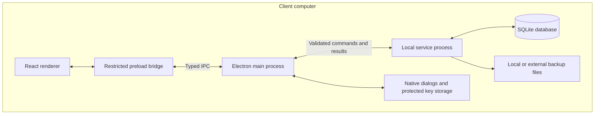
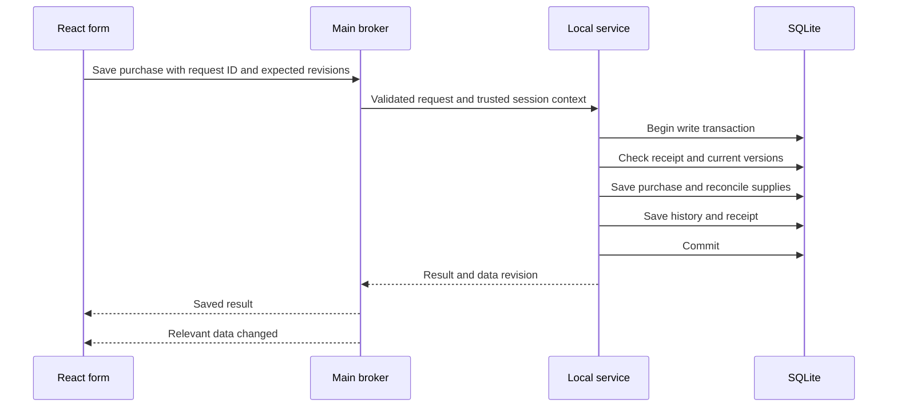
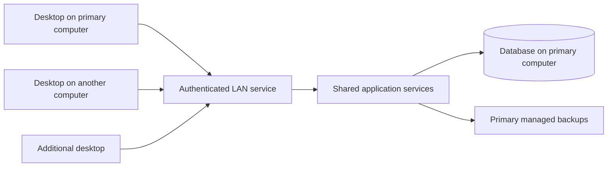

# Medi Pharm Desktop architecture

Build one installable application containing the interface, local business services, and SQLite runtime. A dedicated local service process owns the database. The desktop window calls that service through a restricted API managed by Electron. No HTTP server or network port is needed for the single-computer release.

The application runs only while open. It has no required startup service, tray agent, cloud connection, or internet-dependent login. Windows 10 and 11 use the same business code with platform-specific adapters for directories, dialogs, protected key storage, and packaging.

## Process structure



Electron separates window management from rendering and provides preload bridges for privileged operations. Use its utility-process facility for the local Node.js service host. [Electron process model](https://www.electronjs.org/docs/latest/tutorial/process-model), [utilityProcess](https://www.electronjs.org/docs/latest/api/utility-process)

| Component | Owns | Boundary |
| --- | --- | --- |
| Renderer | React screens, forms, view state, query cache, previews | No SQLite, filesystem, shell, Node.js, or secret-store access |
| Preload | Narrow methods exposed as `window.mediPharm` | No generic IPC sender, arbitrary channel, or executable code input |
| Main process | App lifecycle, windows, IPC sender checks, native dialogs, service supervision, OS key access | Does not contain purchase rules or run large synchronous queries |
| Service process | Authentication, validation, application services, database connection, migrations, backup jobs | Accepts only registered commands from the main-process broker |
| Domain modules | Date rules, quantities, supply calculations, invariants | Independent of Electron, React, filesystem, and database drivers |
| Repository modules | Queries, transactions, persistent mappings | Used only within service modules |

The single service process keeps SQLite writes centralized and synchronous database work away from the window. It is a child of the app, not an operating-system service. Main and child monitor each other's lifecycle; a lost parent connection causes child shutdown. Test process cleanup after normal exit and forced termination.

## Technology assignments

| Technology | Assignment |
| --- | --- |
| Electron | Desktop lifecycle, restricted process bridge, native integration |
| React and TypeScript | Interface and shared typed contracts |
| Vite | Bundle renderer, main, preload, and service entry points |
| Tailwind CSS and shadcn/ui | Accessible controls and consistent styling |
| React Hook Form and Zod | Form handling and runtime input schemas |
| SQLite and better-sqlite3 | Embedded local database and backup interface |
| Reviewed SQL and typed projections | Authoritative immutable DDL, parameterized queries and runtime schema verification; an ORM remains optional |
| Node.js crypto | Password KDF, random identifiers/keys, hashes, authenticated archive encryption |
| Electron Forge | Native dependency rebuilds, packaging, installers |
| Vitest and Playwright | Domain/integration tests and desktop workflow automation |

Pin a compatible toolchain and lockfile in milestone 0. The Forge Vite integration is documented as experimental; validate and pin its exact version rather than accepting untested minor upgrades. [Forge Vite plugin](https://www.electronforge.io/config/plugins/vite)

## Command and query contract

Expose methods such as `customers.search`, `customers.save`, `purchases.previewSupply`, `purchases.save`, `purchases.cancel`, `followUps.contact`, `backup.start`, and `backup.inspect`. Reads and writes use separate schemas. Enumerate export kinds; never accept a caller-provided table name, SQL fragment, arbitrary path, or command to execute.

A mutation request carries a request UUID, protocol version, validated input, record version where relevant, and a supply revision when it uses an estimate. Main attaches the trusted sender/session context. Actor and pharmacy identifiers come from the authenticated service context, not user input.

Return one of:

- Success with a small result, affected identifiers, and a change revision.
- Validation failure with field-level errors.
- Conflict with a refresh/review instruction that preserves the draft.
- Authentication required, without discarding the current form.
- Storage unavailable or full, when no commit occurred.
- Outcome unknown, when the connection was lost and commit status cannot be established.

The UI creates one request UUID per intended submission. An uncertain retry sends the same UUID and the frozen original payload. Editing a form after an uncertain outcome must not silently turn that retry into a different command. The service consults the transactional receipt before applying any repeat write; see [database transactions](DATABASE_PLAN.md#transactions-and-retries).



After a successful mutation, update or invalidate affected queries and announce the result accessibly. Process events are hints to refresh; database queries remain authoritative. A dropped event is repaired on route entry, focus/resume, or explicit refresh. SSE and WebSockets are unnecessary in this local release.

## Authentication and local access

Propose a one-time offline owner setup with pharmacy name, owner identifier, and passphrase. Store a salted, versioned password hash using a reviewed scrypt configuration, with parameters recorded alongside it. Calibrate a bounded cost on the minimum target hardware before release; do not use a fast general-purpose hash for passwords. Node provides the underlying cryptographic primitives. [Node.js crypto](https://nodejs.org/api/crypto.html)

The service keeps sessions in memory, bound through main to the authorized window. No JWT, web cookie, or database session surviving app shutdown is required. Check authorization for every protected read and write, not only when showing the UI. Proposed session lifetime is eight hours; expiry presents a reauthentication dialog and preserves the current in-memory draft. App restart, logout, password change, or service restart invalidates sessions.

Persist a local failed-login counter so restarting the app does not reset throttling. Provide an owner-held offline recovery code, stored as a hash and rotated when used. Password recovery requires that code, replaces the password, clears sessions, and records an audit event. There is no support backdoor or email-reset dependency. Backup decryption is a separate credential; resetting app login does not decrypt an archive.

An OS user or administrator who can access the unencrypted database can bypass application-level controls. Live database encryption would be a separate storage/key-recovery design decision. This plan provides OS file access restrictions and encrypted portable backups, without representing local login as database encryption.

## Desktop boundary protection

Use context isolation, renderer sandboxing, disabled renderer Node integration, restrictive content security policy, and an exact allowlist of IPC methods and trusted sender frames. Load packaged content through a constrained custom application protocol. Restrict navigation and new windows; native file and folder dialogs return validated, narrowly scoped handles/IDs to business commands. These boundaries follow [Electron's security guidance](https://www.electronjs.org/docs/latest/tutorial/security).

Package all fonts, scripts, icons, and styles locally. Disable telemetry, remote crash uploads, online update polling, and remote content loading in production. The packaged runtime must not start the Vite development server. Use a production protocol handler that serves only packaged assets and rejects traversal outside its asset root.

Validate request size and result size. Do not log passwords, recovery codes, backup keys, phone numbers, customer notes, or full business payloads. Redacted local diagnostic logs use bounded rotation and remain on the computer. Support export of diagnostics is an explicit local file operation.

## Startup and shutdown

1. Establish stable application identity and platform data directories before session initialization.
2. Acquire the application single-instance lock. A second launch focuses the existing window and exits.
3. Inspect any unfinished migration/restore journal before opening the business database.
4. Start the service process and validate installation markers, file permissions, database identity, and schema compatibility.
5. Complete required recovery or migrations under exclusive application maintenance mode. A failed operation keeps normal writes disabled.
6. Show first-run setup, restore, or login as appropriate. Authenticate, then load current dashboard state.
7. Check due backups after login and on resume; refresh due reminders against the pharmacy's calendar date.

On normal quit, stop accepting new commands, confirm disposition of unsaved forms, finish or safely cancel active jobs, let the current transaction commit/roll back, close SQLite, and terminate the child. A forced OS shutdown can bypass normal quit handlers, so data correctness must come from transactions and recoverable jobs rather than a last-second save. [Electron lifecycle API](https://www.electronjs.org/docs/latest/api/app)

Quit the application when its final main window closes on Windows and Linux development builds, matching the requirement that services stop with the app. Users can minimize the window if they want the app and its backup scheduler to remain active.

Committed records survive a crash; unsaved forms are only in memory in this baseline. Persistent draft recovery would need an explicit future feature and privacy decision.

## Files and environment isolation

Use the paths and storage rules in [the database plan](DATABASE_PLAN.md#permanent-directories). Keep business data, Chromium cache, OS-protected key material, operational logs, and backup staging in distinct subdirectories. Changing product display text must not change the persistent storage identity.

Development uses a separate data root and app identity. Tests use a newly created temporary root and synthetic fixtures. Production data is never a fallback when a test root is missing. Packaged production builds cannot accept a test flag that bypasses login or resets the database.

## Source structure

```text
medi-pharm-desktop/
  README.md
  OVERALL_PLAN.md
  ARCHITECTURE.md
  DATABASE_PLAN.md
  BACKUP_AND_RECOVERY.md
  BUILD_AND_RELEASE.md
  src/
    main/              lifecycle, protocol, native adapters, IPC broker
    preload/           restricted renderer API
    renderer/          React routes, components, forms, query state
    service/           child-process host and command registration
    application/       business commands and queries
    domain/            pure calculations and invariants
    db/                schema, repositories, transaction helpers
    backup/            archive, verification, retention, restore jobs
    contracts/         request/result schemas and protocol version
    platform/          paths, key storage, volume identity abstractions
  migrations/          numbered SQL and checksums
  tests/
    unit/
    integration/
    desktop/
    recovery/
  assets/              bundled fonts, icons, installer artwork
  build/               packaging configuration and entitlements
```

This is the target production layout. The current synthetic prototype implements only a subset; see the README and phase verification notes for actual progress. Keep platform adapters thin. Supply rules should be testable without starting Electron; repositories should be testable against a temporary SQLite file.

## Future LAN boundary



Reuse application services behind a new network transport when LAN operation is requested. The primary computer becomes the authority for writes, authentication, dates, change notifications, and backups. Reassess database capacity and concurrency then; SQLite behind one service may be sufficient for a small load, but that is a measured decision.

Clients never open the SQLite file through a shared network folder. SQLite WAL requires cooperating database processes on the same host, so a LAN API must own access. [SQLite WAL documentation](https://www.sqlite.org/wal.html)

LAN work adds authenticated pairing, TLS/certificate handling, device access management, firewall setup, protocol compatibility, primary-host availability, and concurrency tests. Without the primary computer/service, clients cannot save in the shared dataset. Disconnected client writes and synchronization are not implied by LAN support. No LAN functionality is implemented as part of this initial plan.
