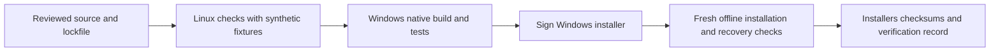

# Medi Pharm Desktop build and release plan

Develop the application on Linux and produce tested Windows 10 and 11 installers from the same source revision. Native release jobs run on their target operating systems. Internet access on development/build machines is separate from the installed app: the client's pharmacy records remain local and the runtime works offline.

This plan selects Electron Forge for packaging. Dependency versions, exact supported OS versions, signing identities, and final CPU targets are settled during the platform prototype rather than assumed from the developer's Linux machine.

## Platform and artifact matrix

| Environment | Purpose | Proposed output |
| --- | --- | --- |
| Linux workstation | Daily coding, Electron development run, unit/integration tests | Development build using a separate data root |
| Windows x64 runner or machine | Native SQLite rebuild, desktop tests, packaging, signing | Signed full setup `.exe` |

Windows x64 is the initial implementation target; confirm the Windows 11 laptop architecture before its native build. Windows ARM64, macOS, and Linux customer installers are outside this release. Windows 10 requires separate verification; Windows 11 results do not certify it.

Use native Windows builds for the Squirrel installer and SQLite module. The user has a Windows 11 laptop for manual testing; daily development remains on Linux. [Squirrel.Windows maker](https://www.electronforge.io/config/makers/squirrel.windows)

## Linux development setup

1. Create the project with TypeScript, React, Electron Forge, and Vite entry points for main, preload, renderer, and local service.
2. Select a development Node.js version compatible with the chosen build tools. Electron includes its own runtime; the client does not install Node.js or pnpm.
3. Pin dependency versions and commit a lockfile. Use pnpm with the packaging layout required by Forge; its current instructions call for `node-linker=hoisted`.
4. Install Linux native build prerequisites needed by the selected SQLite driver and a usable desktop session for Electron development tests.
5. Use a development-only product identity and data root. Keep synthetic fixtures isolated from any owner database.
6. Define scripts for development, lint, typecheck, unit tests, SQLite integration tests, desktop tests, recovery tests, package, and make. These script names are planned deliverables, not commands available in this planning folder yet.

Forge provides packaging and native dependency rebuild support. Its Vite integration is experimental, so pin and verify it during upgrades. [Forge setup](https://www.electronforge.io/), [Forge Vite integration](https://www.electronforge.io/config/plugins/vite)

Most business development can happen on Linux. Target OS dialogs, key stores, application-data paths, filesystem replacement behavior, signing, and installers still need Windows 10/11 execution. The Windows 11 laptop provides the first native test environment. Arrange Windows 10 testing before claiming support for both versions.

## Native dependency packaging

`better-sqlite3` includes a native binary. Build/rebuild it for the exact Electron runtime, OS, and architecture used by each artifact. Do not copy Linux `node_modules` into a Windows 10 or 11 release. Electron native modules need compatible ABI builds, and Forge integrates Electron rebuild tooling. [Electron native module guide](https://www.electronjs.org/docs/latest/tutorial/using-native-node-modules)

Keep native dependencies external to the JavaScript bundle and unpack the required native files from ASAR packaging. Verify resolution from the utility-process service entry point in the installed app. Include required migration SQL and bundled assets, and verify their packaged paths. An unpackaged development build succeeding is insufficient evidence.

For each platform prototype, demonstrate database creation, a committed write, close/reopen, a live backup, restore to a fresh profile, and a key-store round trip. Record Electron, embedded Node, driver, SQLite, architecture, and OS versions in the build report.

## Stable identity and persistent storage

Choose and retain a stable internal application name, application/bundle ID, publisher, data-root identity, installer upgrade identity, and backup format namespace. Final naming is a milestone-0 decision. User-facing branding can change without moving the data directory.

Install executable resources separately from the persistent directories in [the database plan](DATABASE_PLAN.md#permanent-directories). The installer and uninstaller must preserve business records by default. Updating the executable never replaces the live database with a packaged fixture. A deliberate data reset, if later added, must be a separate authenticated workflow with a backup.

Test the installed Windows application, paths with spaces/non-ASCII usernames, OS account permissions, and repeated launch behavior.

## Build pipeline

Release jobs may use locally owned machines or CI runners. They receive source, synthetic tests, and appropriately restricted signing credentials. They must never receive real customer databases or backups. Installing dependencies and obtaining signing timestamps may require internet on the build machine; neither operation creates a runtime cloud database dependency.

Keep signing credentials outside the repository. Use a controlled signing environment and record the source commit, lockfile hash, artifact hash, dependency versions, and test results. Do not promise byte-for-byte reproducibility for signed artifacts, whose timestamps and signatures can vary.

## Windows signing

Use a supported Windows Authenticode signing arrangement for customer releases. Final certificate/provider ownership and cost are a business decision. Signing establishes publisher identity; do not promise that it eliminates every Windows reputation or security prompt. [Windows signing guidance](https://www.electronforge.io/guides/code-signing/code-signing-windows)

Native driver loading, utility-process execution, and DPAPI access must work in the final signed Windows build. Early test artifacts are unsigned prototypes and must be labelled accordingly.

## Offline installation and updates

The full installer contains the application runtime, compiled interface, native SQLite driver, migrations, icons, and fonts. No post-install dependency download, CDN asset, online account activation, or required license-server request is permitted.

Distribute a new installer manually, including through an external drive. The user closes the application before replacing it. Installer behavior must detect an existing running instance and request a clean exit rather than replacing files while a database operation is active.

On the next launch, the runtime checks schema compatibility and runs the migration protocol from [the database plan](DATABASE_PLAN.md#migrations-and-updates). A pre-migration backup is a prerequisite for changing an existing schema. If the OS key store is unavailable, prompt for the backup passphrase or pause the update's data migration; do not proceed without a usable safety snapshot.

Installing an older executable does not automatically roll back data. Refuse writes when the database schema is too new and provide a supported recovery route. If returning to a prior application version requires restoring its pre-update backup, clearly state that later changes would be lost. Prefer forward corrective migrations whenever possible.

No remote auto-updater is required. A future online update feature must be optional and separately specified. The release process still needs periodic dependency/security maintenance even if customers install updates manually.

## Test layers

| Layer | What it demonstrates |
| --- | --- |
| Pure unit tests | Calendar arithmetic, supply decisions, exact quantities, validation, state transitions |
| SQLite integration tests | Real files, migrations, transactions, constraints, receipts, concurrent/stale requests |
| Desktop automation | IPC authorization, forms, draft retention during reauthentication, notifications, navigation |
| Recovery tests | Portable archives, encryption failures, interrupted backup/restore/migration, new-device recovery |
| Native installer tests | Setup, permissions, signatures, key-store access, update, uninstall/reinstall, path preservation |
| Disconnected target tests | First launch and all required runtime flows work with networking disabled |

Playwright's Electron automation is experimental. Pin it and prove that it can drive the selected Electron build early. Its inspector requirements may differ from a hardened production artifact; keep test instrumentation out of customer builds and perform separate smoke tests on the exact final signed installers. Do not disable production protections simply to satisfy an automation harness. [Playwright Electron API](https://playwright.dev/docs/api/class-electron)

Mock native dialogs for deterministic automated workflows, then exercise real dialogs and external drives manually on the target OS. Verify there are no leftover utility processes after app exit and no boot/login registration created by the installer.

## Release checklist

- [ ] Exact supported OS versions and CPU architectures are written in the release notes.
- [ ] Build and lockfile versions are pinned and native dependencies load on each target.
- [ ] Relevant embedded SQLite fixes and dependency advisories have been reviewed.
- [ ] Business tests, data migration tests, and failure-injection recovery tests pass.
- [ ] Offline first install, owner setup, login, save, restart, backup, and restore pass on clean targets.
- [ ] Windows 10-to-11 and Windows 11-to-10 backup restoration pass without the original key store.
- [ ] Final signed Windows artifacts pass OS-specific launch and native-dialog tests.
- [ ] No test bypass, seed data, local database, backup archive, development server, or signing secret is packaged.
- [ ] Network observation confirms the app does not initiate third-party runtime traffic.
- [ ] Update, failed migration, attempted downgrade, uninstall/reinstall, and data preservation are verified.
- [ ] Offline setup, recovery, backup-passphrase custody, and supported-version instructions accompany the installers.
- [ ] The owner completes a representative workflow and a sample restore on their actual hardware.

Publishing artifacts, provisioning CI, purchasing signing services, and creating developer accounts are future implementation/release tasks. This planning package does not perform those actions.
