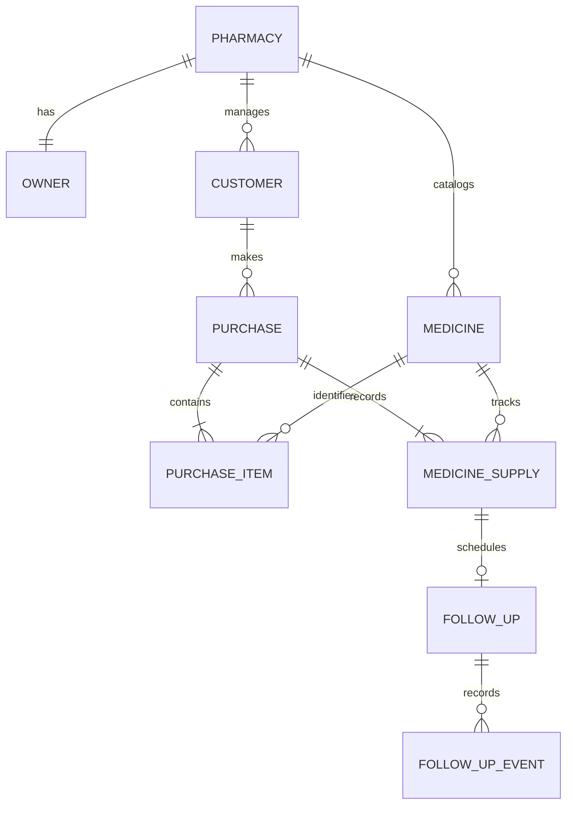

# Medi Pharm Desktop database plan

Use one SQLite database for the pharmacy's authoritative business records, accessed by the application's local service process. The database is a persistent file; SQLite does not run as an independent background server. Open it when the app starts, commit each business operation explicitly, and close it when the app exits.

The schema below is a proposed fresh desktop schema using the current demo's medicine-level workflows. It does not reproduce PostgreSQL-specific structures or silently import existing demo data. Business feature changes may alter the schema before implementation.

## Current implementation

The development preview uses `src/db/migrations/0001.ts` as authoritative reviewed SQL through better-sqlite3. Typed application projections validate its results; Drizzle is deferred rather than maintaining a second schema definition without a repository need. Startup compares both the checksum ledger and actual tables/indexes/triggers against that DDL, then checks dataset identity, integrity, foreign keys, credentials, and currently implemented date/relationship invariants.

Setup builds and commits privately in staging. A prepared replacement journal is flushed only after the candidate is complete and verified. Startup resolves that journal before creating/opening the live directory. Before publication, an abandoned setup does not claim an initialized pharmacy. After preparation, recovery completes the verified generation or stops without deleting either dataset. A legacy partial claim still requires recovery.

The shared mutation runner performs authorization, canonical payload hashing, receipt replay, synchronous mutation, audit/revision writes and receipt insertion in one immediate transaction. Sequence allocation requires that surrounding transaction. Quantity/date helpers use exact thousandths and date-only calendar arithmetic. Business commands now implement catalogue edits, purchases, supply-chain reconciliation, and follow-up actions through that runner. Purchase previews use the whole database revision as a conservative context token. Startup/backup/restore checks verify item-to-supply correspondence, sequence counters, carried-day calculations, current reminder eligibility and saved paused-cycle state.

Backups use verified SQLite snapshots; restore stages and validates candidates, preserves the prior live directory and requires a fresh login. Device identity, key configuration, destinations and backup history stay outside the restored database. Only schema version 1 is supported; automatic existing-schema upgrades remain disabled until a concrete migration and its recovery rehearsal exist. See [backup/recovery evidence](docs/verification/BACKUP_AND_RECOVERY.md).

## Permanent directories

Resolve platform paths through a tested platform adapter. Keep a stable internal product identity independent of the name displayed in the title bar.

| Platform | Proposed production root |
| --- | --- |
| Windows | `%LOCALAPPDATA%\MediPharm Desktop\` |
| Linux development | `${XDG_DATA_HOME:-~/.local/share}/medi-pharm-desktop-dev/` |
| Automated tests | A unique temporary directory created for that test run |

The Windows adapter resolves the user's local application-data location; it does not assume `C:` or a particular username. Override Electron's runtime/cache paths explicitly where necessary. Electron's default `userData` derives from `appData` and should not be assumed to equal the Windows LocalAppData example. Keep Chromium session files separate from business data. [Electron path API](https://www.electronjs.org/docs/latest/api/app)

```text
MediPharm Desktop/
  data/
    live/
      medipharm.sqlite
      medipharm.sqlite-wal       present when SQLite needs it
      medipharm.sqlite-shm       present when SQLite needs it
  runtime/                      Electron cache and session files
  settings/
    installation.json           local installation and initialization identity
    device.json                 backup destinations and device preferences
    backup-key.protected        OS-protected local copy of backup master key
    backup-key-envelope.json    portable passphrase-wrapped key metadata
  operations/
    backup-history.jsonl        bounded operational record per destination
    restore-journal.json        exists only during a restore/recovery operation
    migration-journal.json      exists only during migration/recovery work
  backups/                      completed encrypted local archives
  staging/                      private temporary job directories
  recovery/                     retained pre-restore or pre-migration datasets
  logs/                         bounded redacted diagnostics
```

Restrict these directories to the OS account and necessary system access. The application does not upload them or place them in a cloud-sync directory by default. OS backup/sync tools configured by the owner remain outside the app's control; deployment should verify the actual selected locations.

Never store the live database inside the app bundle, installation directory, source repository, temporary directory, external removable drive, or network share. External drives are backup destinations. Each OS user profile has its own installation data; sharing one pharmacy across several OS logins is outside the initial design.

After initialization, a missing database is a recovery condition. Validate the installation marker and open with a must-exist option. Only explicit first-run setup creates a new database. An unreadable, corrupt, or newer-schema database must not trigger automatic empty-database creation.

## Connection ownership and configuration

One service process owns one primary read/write connection through `better-sqlite3`. Typed parameterized queries operate through that connection; any future ORM must use the same service-owned connection. Temporary read-only verification connections to completed snapshots are allowed; they are closed before restore or replacement. Do not build a PostgreSQL-style connection pool for this application.

On every applicable connection, set and verify the configuration rather than relying on defaults:

```sql
PRAGMA foreign_keys = ON;
PRAGMA journal_mode = WAL;
PRAGMA synchronous = FULL;
PRAGMA busy_timeout = 5000;
```

`foreign_keys` enforces relationships. WAL supports local read/write behavior; `FULL` prioritizes committed-data durability. The busy timeout bounds waits for another holder. Treat these as proposed settings to verify on packaged target builds. SQLite documents these controls and requires foreign-key enforcement to be explicitly enabled outside a transaction. [SQLite PRAGMA reference](https://www.sqlite.org/pragma.html), [foreign-key support](https://www.sqlite.org/foreignkeys.html)

Record the actual SQLite engine version in diagnostics and release verification; it is the version shipped by the selected native driver. Check relevant upstream fixes before pinning a release. Never delete a live WAL or SHM file as routine cleanup. WAL files can contain committed changes that are not yet in the main file. [SQLite WAL documentation](https://www.sqlite.org/wal.html)

Use parameterized queries, disabled extension loading, bounded input, paginated reads, and a controlled schema. Use `STRICT` tables where supported by the pinned SQLite migration path; if generated DDL needs adjustment, check in and test the explicit SQL. Persistence rules must not depend only on TypeScript types.

## Representation rules

| Value | Representation and rule |
| --- | --- |
| Entity ID | UUID as canonical `TEXT`, generated by the application |
| Pharmacy ID | Explicit on scoped records; one pharmacy initially |
| Boolean | `INTEGER` constrained to 0 or 1 |
| Business date | Canonical `YYYY-MM-DD` text, validated as a real calendar date |
| Event timestamp | UTC epoch milliseconds as `INTEGER` |
| Quantity | Integer thousandths, for example 1.250 tablets is 1250 |
| Supply duration | Whole days, constrained to 1–365 |
| Remaining override | Nullable whole days, 0–365; null means use the estimate |
| Version | Positive integer incremented on each applicable change |
| JSON payload | Versioned JSON in `TEXT`, with JSON validity and application-schema validation |
| Currency | Not part of the current baseline; future money values require an explicit exact representation |

Parse quantity from its input string using decimal arithmetic and reject more than three fractional digits. Do not calculate thousandths by multiplying an imprecise floating-point value and assuming it is exact. Baseline quantity bounds are greater than zero and at most 999999 units, equivalent to `1..999999000` stored thousandths.

Use Asia/Kolkata for pharmacy business dates, regardless of the computer's timezone. Store the timezone on the pharmacy record, with this fixed default for the initial baseline. Date-only arithmetic must not turn a business date into a local-midnight JavaScript timestamp. UTC timestamps are for events, not supply-date calculations. The system clock is the offline time source; detect major backward jumps and show a clock check rather than silently rewriting dates.

Store display text separately from normalized search and identity keys. Preserve phone formatting for display, require a validated normalized phone, and permit shared family numbers. SQLite's default case handling is not a substitute for a defined Unicode normalization strategy.

## Proposed tables

Every business table has a primary key. Scoped relationships use composite keys including `pharmacy_id` where necessary. Include created/updated timestamps and versions where mutable state needs them. No ordinary user flow physically deletes historical purchases, supplies, or follow-up events.

| Table | Principal columns | Constraints and purpose |
| --- | --- | --- |
| `app_meta` | Singleton ID, dataset UUID, data revision, initialized timestamp | Stable dataset identity; increment revision with business commits |
| `schema_migrations` | Ordered migration ID, checksum, applied timestamp | Authoritative migration ledger; applied SQL is immutable |
| `pharmacies` | ID, name, contact, timezone | One row initially; business settings travel with backups |
| `users` | ID, pharmacy ID, normalized owner identifier, password hash/KDF parameters, recovery-code hash, active flag, credential version | One owner per pharmacy; no built-in credentials |
| `auth_attempts` | Normalized identifier key/hash, window start, attempts, blocked-until | Local login throttling persists across restarts |
| `customers` | ID, pharmacy ID, name, name search key, phone, normalized phone, optional age, notes, archive timestamp, version | Phone required; age null or 0–130; phone not unique |
| `medicines` | ID, pharmacy ID, name, strength, form, normalized identity key, archive timestamp, version | Unique identity key per pharmacy, including archived records |
| `number_counters` | Pharmacy ID, counter kind, next number | Allocate purchase display sequence inside the same transaction |
| `purchases` | ID, pharmacy ID, customer ID, display sequence, purchase date, notes, active/cancelled status, version, creator/updater IDs | Sequence unique per pharmacy and immutable; cancellation preserves record |
| `purchase_items` | ID, pharmacy ID, purchase ID, medicine ID, medicine name/strength/form snapshots, quantity thousandths, unit, position | Unique purchase/medicine/unit; positive quantity; constrained units |
| `medicine_supplies` | ID, pharmacy/customer/purchase/medicine IDs, included flag, start date, new days, extend/replace mode, remaining override, remaining used, run-out date, reminder flag, manual reminder date, version | One stable supply row per purchase/medicine; removal sets included false |
| `follow_ups` | ID, pharmacy/customer/medicine/purchase/supply IDs, status, calculated/manual/next dates, last contact timestamp, closure fields, resolving purchase ID, paused-state JSON, version | Unique supply ID; partial unique index allows at most one open follow-up per customer/medicine |
| `follow_up_events` | ID, pharmacy ID, follow-up ID, actor ID, action, note, before/after JSON, timestamp | Append history for contact, snooze, close, reopen, and supply reconciliation |
| `audit_events` | ID, pharmacy ID, actor ID, entity type/ID, action, reason, before/after JSON, timestamp | Append history for business changes and recovery |
| `mutation_receipts` | ID, pharmacy ID, actor ID, request UUID, command, normalized payload hash, result JSON, timestamp | Unique pharmacy/actor/request identity; deduplicate uncertain retries |

Sessions stay in memory and therefore have no persistent table in this baseline. Backup destinations, device key protection, scheduling history, and installation identity belong outside the business database so restoring a different computer's records does not restore its drive letters or claim its backup jobs succeeded locally.

Audit history provides application accountability, not proof against an OS administrator editing the file. Do not advertise it as tamper-proof.

### Relationship model



Purchase and supply records retain historical medicine snapshots even if the catalog is renamed. Referential constraints protect existing records. Application validation additionally verifies that a follow-up's customer, medicine, purchase, and supply describe the same relationship; independent foreign keys alone do not prove that correspondence. Customer corrections reconcile both the old and new chains within one transaction.

### Required checks and indexes

- Constrain enums, booleans, quantities, supply-day bounds, nonnegative carried days, valid JSON, and positive versions in SQL.
- Enforce unique medicine identity, purchase sequence, item medicine/unit, supply purchase/medicine, follow-up supply, and mutation receipt identity.
- Enforce open follow-up closure fields are null; closed follow-ups require a closure reason/time. A superseded cycle cannot remain open.
- Define the open-follow-up unique index on `(pharmacy_id, customer_id, medicine_id)` where status is open.
- Index customer name-search key and normalized phone with pharmacy ID, and medicine identity/search keys with pharmacy ID.
- Index purchases by customer/date/sequence and by pharmacy/date/sequence; index items by medicine/purchase.
- Index supply chains by pharmacy/customer/medicine and purchase linkage; use purchase date/sequence for chain order.
- Index follow-ups by pharmacy/status/next date and customer; history by parent ID/time/ID; audit by entity/time/ID.
- Validate real calendar dates and cross-record run-out equations in the service. Do not claim a text-format SQL check proves date validity.

Use query-plan inspection on the proposed load dataset. Start with ordinary normalized search and pagination; add full-text search only if measured use requires it.

## Supply and reminder invariants

These business rules are the baseline confirmed unchanged on 10 November 2026:

```text
lead_days = min(7, max(1, floor(new_days * 0.25 + 0.5)))
estimated_remaining = max(0, calendar_days_between(start, previous_run_out))
remaining_used = 0 for replace, or override/estimate for extend
run_out_date = supply_start + remaining_used + new_days
calculated_reminder_date = run_out_date - lead_days
```

The same medicine in multiple unit rows has one supply duration. Each distinct medicine has its own optional reminder. New supply days are 1–365. Start cannot precede purchase; purchase cannot be in the future. Manual reminder dates cannot precede purchase; dates at or beyond run-out require explicit confirmation. One-day supplies naturally produce a reminder on the start date when nothing is carried.

Seven days starting 1 November run out on 8 November. An 11-day refill starting 4 November carries four days in extend mode, runs out on 19 November, and reminds on 16 November. Replace mode runs out on 15 November and reminds on 12 November. The three-day lead depends only on the new 11 days.

Order a customer's medicine chain by purchase date and immutable sequence. Supply starts must be nondecreasing along that chain. Recompute dependent supplies after a correction or cancellation; later replace entries reset coverage and explicit remaining overrides stay owner assertions. Reject an out-of-range computed date rather than saving a malformed value.

A later supply supersedes the preceding follow-up even when the new reminder is disabled. Preserve prior manual closure, contact, and snooze state in versioned paused-state data. If the later supply is cancelled, restore the previous eligible state. Contact alone does not close a follow-up; another medicine's purchase does not close it. Close superseded open records before restoring the current one, so the partial unique index remains satisfied throughout the transaction.

## Transactions and retries

SQLite permits one simultaneous writer. Serialize business commands in the service and use immediate transactions for mutations that read and then update related records. Avoid PostgreSQL row-lock syntax. [SQLite transactions](https://www.sqlite.org/lang_transaction.html)

For a purchase command:

1. Validate the request envelope and input types, then resolve the authenticated actor.
2. Begin the write transaction. Look up its receipt using pharmacy, actor, and request UUID.
3. If a matching receipt exists, return its result. Reject reuse with a different command or normalized payload hash.
4. Load authoritative customer, catalog, purchase, and affected supply-chain states.
5. Check record versions and the expected chain revision. Derive the revision from all relevant supply, purchase, and follow-up versions; include removal/cancellation changes.
6. Allocate any new display sequence. Save header, item snapshots, supplies, and chain reconciliation atomically.
7. Append audit/follow-up events, advance data revision, and save the mutation receipt.
8. Commit before returning success or emitting a change event. Any failure rolls back the whole business command.

Keep synchronous database transaction callbacks free of `await`, network requests, dialogs, encryption, and file copies. The better-sqlite3 transaction interface cannot keep an asynchronous callback inside the intended transaction. Its backup method is a separate asynchronous job. [better-sqlite3 API](https://github.com/WiseLibs/better-sqlite3/blob/master/docs/api.md)

Retain mutation receipts for the initial release; do not prune them without defining a safe retry horizon. Version checks still matter on one computer because multiple windows, delayed previews, and edits can race. A known rollback and an unknown commit outcome are different UI errors.

## Migrations and updates

Generate migrations during development, review their SQL, and ship immutable numbered migrations and checksums with the application. Never run schema generation or schema push against an owner's database. The runtime migration ledger is authoritative; do not maintain conflicting version sources.

Startup validates dataset identity, current schema, and the applied migration checksums. If the database is newer than the executable supports, open a compatibility/recovery screen and refuse writes. First-time setup creates the schema through the same migration chain as updates.

Before updating an existing schema, enter maintenance mode, finish commands, create a verified pre-migration snapshot, record a recovery journal, and apply supported migrations. Prefer transactional changes. A migration requiring an SQLite table rebuild must have explicit preservation of keys, indexes, checks, and relationships and be exercised on realistic data. Run relationship and integrity checks afterwards, record migration success, then enable normal operations.

On failure, do not continue with a partly upgraded database. Roll back the transaction or restore the verified pre-migration dataset through the journaled recovery path. Do not downgrade a newer database merely because an older installer was run. The [backup plan](BACKUP_AND_RECOVERY.md) defines staging and replacement mechanics.

## Data import boundary

New desktop installations start empty. No PostgreSQL SQL dump, web JWT/session record, or existing `.env` file is directly compatible with this design. If import is later requested, build a separate one-time exporter/importer using a versioned portable format, validated UUID mapping, exact quantity conversion, preserved dates/history, and row-count reconciliation.

Do not guess individual medicine durations from legacy shared purchase durations. That requires a specific user-reviewed mapping or a separately specified legacy representation. Never import demo data as real pharmacy records by default.

## Verification work

Use a temporary file-backed database per integration test. Verify migrations from empty and prior released versions, foreign-key enforcement, uniqueness, exact quantity round trips, calendar boundaries, mixed units, independent reminders, early refills, zero remaining overrides, and manual dates.

Exercise earlier/latest purchase correction and cancellation, customer moves, removed and re-added medicines, restoration of manual closure/contact/snooze state, and stale simultaneous saves. Confirm lost responses replay one receipt and produce one purchase. Inject errors between each stage of a command and confirm no partial records remain.

Test full/read-only disk, existing file missing, incompatible schema, corrupt copy, native process crash, and restart after forced termination. After backups/restores and migration rehearsals run both `PRAGMA integrity_check` and `PRAGMA foreign_key_check`; the integrity check alone does not detect foreign-key errors. Also verify business totals and representative histories. [SQLite verification pragmas](https://www.sqlite.org/pragma.html#pragma_integrity_check)

Real power-loss durability depends on the filesystem and hardware honoring writes. Transaction configuration and crash tests reduce risk; they are not a substitute for separate backups.
